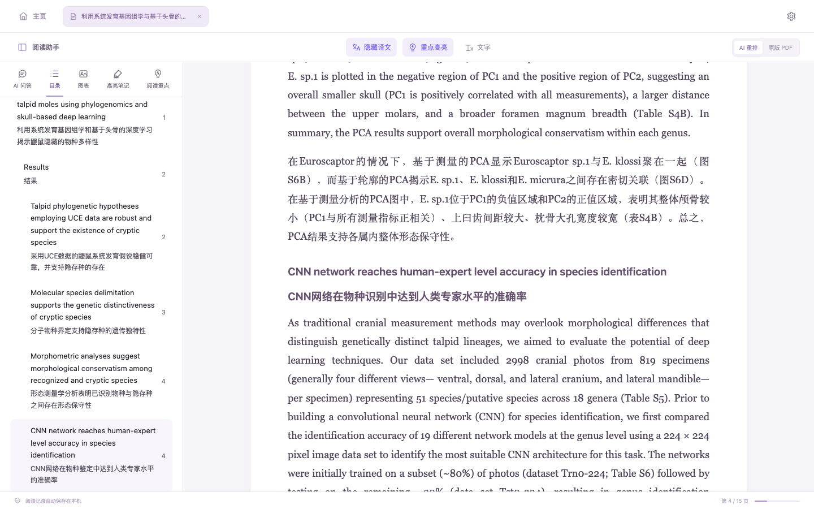
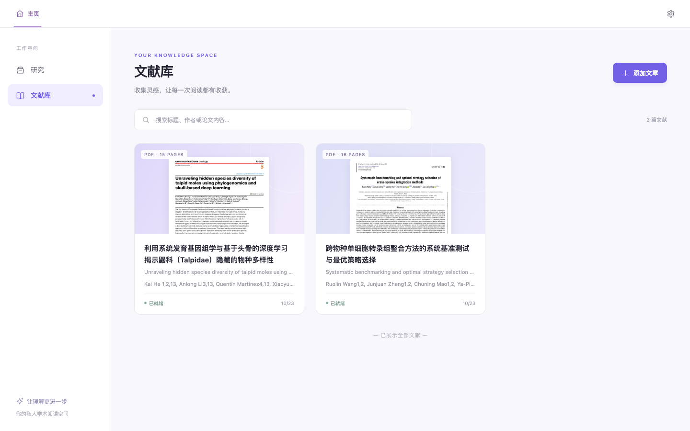
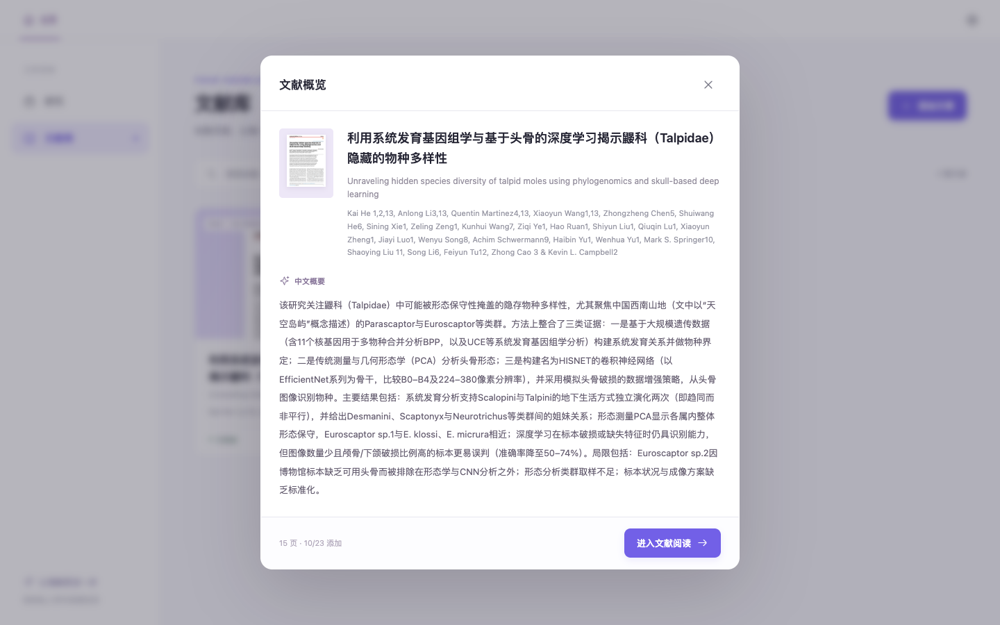
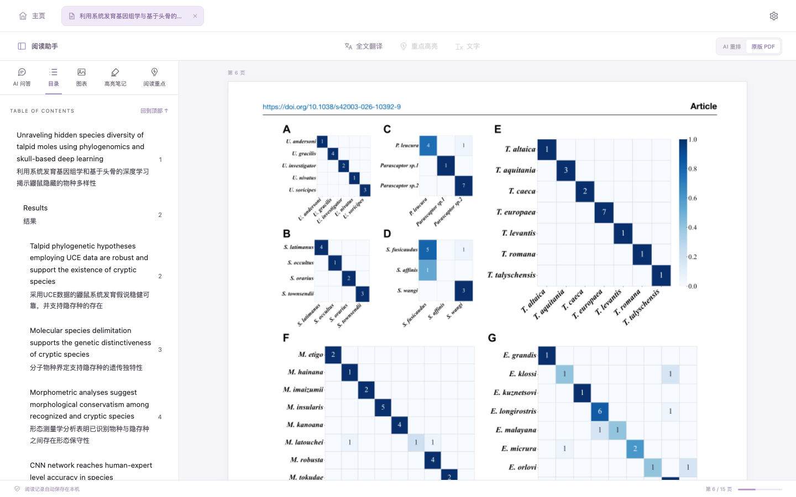
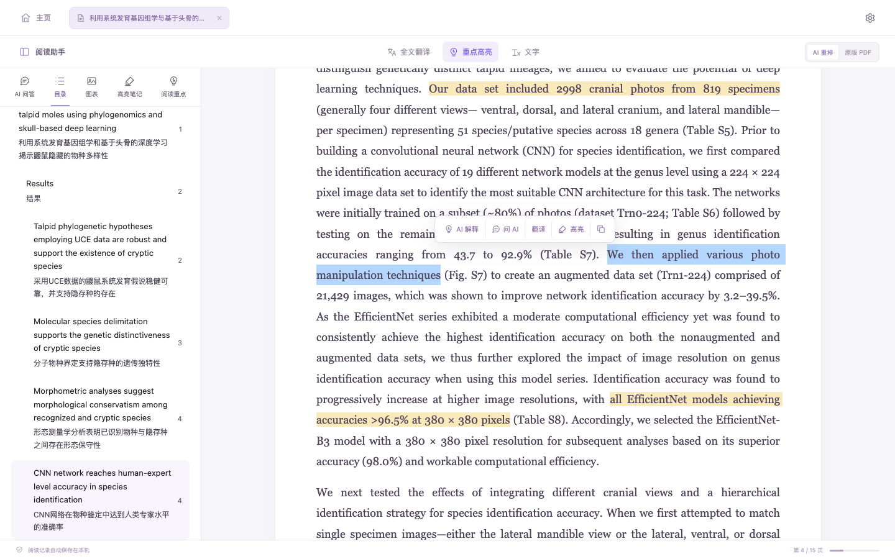
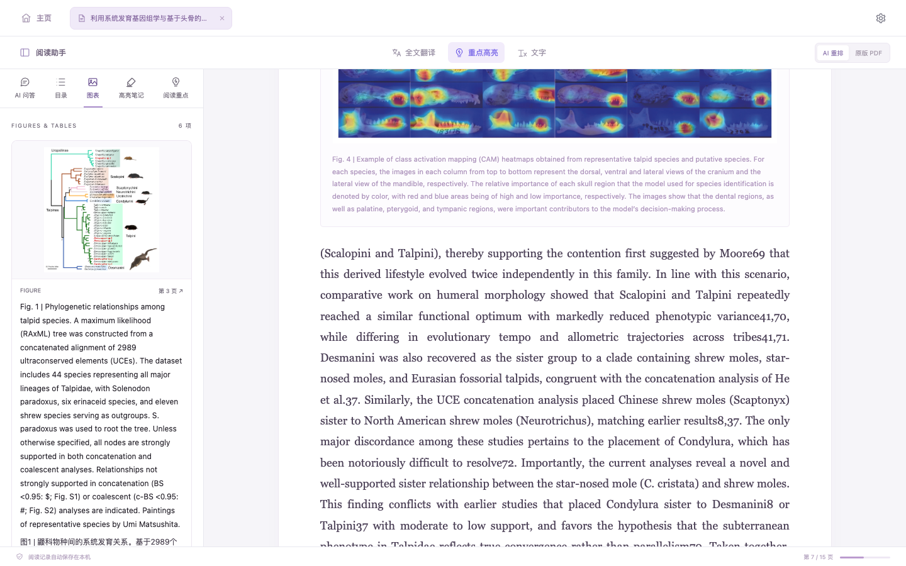
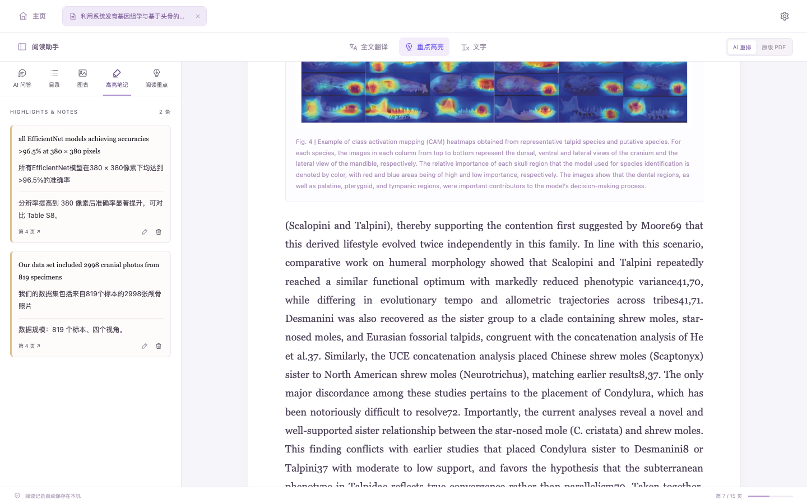
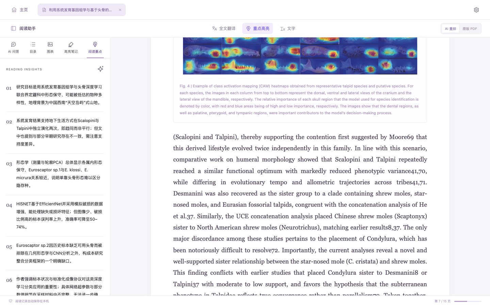
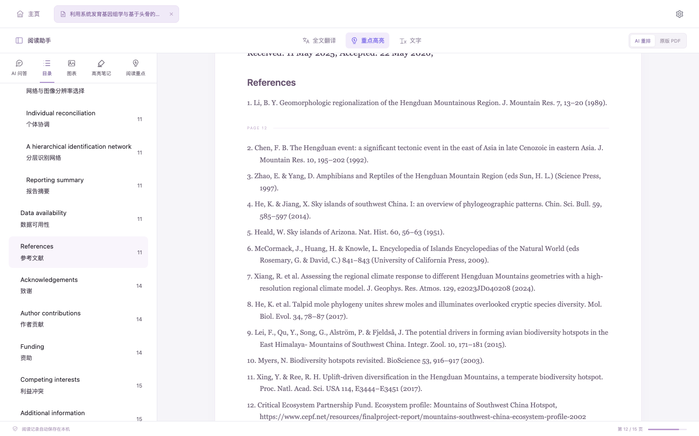
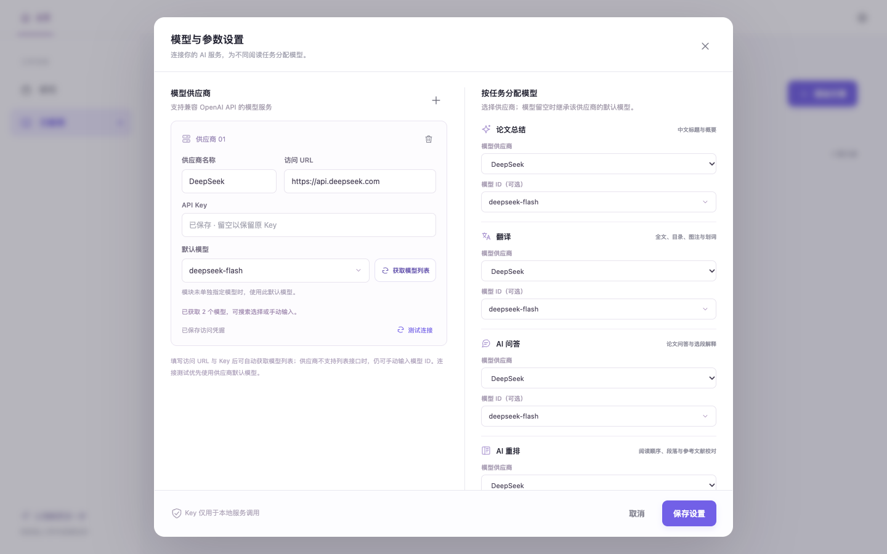

# PaperLens · 论文透镜

**在本机运行的 AI 论文阅读器。** 导入 PDF 后，PaperLens 会把双栏、跨页、夹着图表的论文整理成连贯的单栏阅读视图，并把中文总结、全文双语对照、图表浏览、划词问答和高亮笔记放在同一个工作空间里。

- 论文、译文、笔记和阅读记录都保存在本机，只有你主动使用的 AI 功能才会把相关文本发送给你配置的模型服务。
- 支持任意 OpenAI API 兼容的模型服务（DeepSeek、OpenAI、各类国内外供应商及本地部署）。
- 下载对应平台的完整包解压即可使用，无需安装 Python、Conda、Node.js 或任何构建工具。



## 目录

- [功能一览](#功能一览)
- [界面预览](#界面预览)
- [快速开始](#快速开始)
- [版面是怎么整理的](#版面是怎么整理的)
- [本地存储与隐私](#本地存储与隐私)
- [运行环境](#运行环境)
- [项目结构](#项目结构)
- [开发与验证](#开发与验证)
- [已知限制](#已知限制)

## 功能一览

| 模块 | 功能 |
| --- | --- |
| 文献库 | 拖放 PDF、选择文件或按本机路径导入；按标题、作者和论文内容搜索 |
| 文献概览 | 自动生成中文标题和论文概要，导入后即可快速判断是否值得细读 |
| AI 重排阅读 | 把多栏版面整理为单栏正文：续接跨栏、跨页和被图表打断的段落，识别标题、图注、表注、公式和参考文献 |
| 全文双语 | 按完整段落翻译正文、目录和图注，译文紧跟原文显示，可随时隐藏；中断后可继续翻译 |
| 原版 PDF | 一键切换回原始排版，核对公式、表格和复杂图形 |
| 阅读助手 | 侧边栏提供双语目录、图表与双语图注、高亮笔记、AI 阅读重点和 AI 问答 |
| 划词操作 | 选中文字后可 AI 解释、针对选段提问、翻译、高亮或复制 |
| 多文档工作区 | 同时打开多篇论文，通过顶部标签切换，各自保留阅读进度 |
| 版面抽查 | AI 抽查解析可疑的页面，确认有误的页面交给视觉模型重新识别版面 |
| 模型配置 | 添加多个供应商，为总结、翻译、问答、版面整理和版面识别分别指定模型 |

尚未配置 AI 时，本地解析出的阅读视图、目录、图表和原版 PDF 都可以正常使用。

## 界面预览

> 以下截图使用的示例论文为开放获取文章 He *et al.*, *Unraveling hidden species diversity of talpid moles using phylogenomics and skull-based deep learning*, Communications Biology (2026)，以及 Wang *et al.*, *Systematic benchmarking and optimal strategy selection of cross-species integration methods*, Briefings in Bioinformatics (2026)，均以 [CC BY 4.0](https://creativecommons.org/licenses/by/4.0/) 许可发布。

### 文献库

导入的论文以卡片形式展示首页缩略图、中文标题、原标题和作者。可以拖放 PDF、选择文件或粘贴本机路径导入，并按标题、作者或正文内容搜索。



### 文献概览

点击卡片查看 AI 生成的中文标题和概要，涵盖研究问题、方法、主要结果与局限，再决定是否进入精读。



### AI 重排与双语阅读

阅读视图把原始版面整理为适合屏幕阅读的单栏正文：被换栏、换页或插图打断的段落重新接成一段，小节标题、图注、表注和参考文献各自独立呈现。开启“全文翻译”后，每段译文紧跟在原文之后，标题和目录同样双语显示。

上方的阅读视图截图即为双语模式：左侧是带中文翻译的目录，正文中上一段的译文、独立的小节标题和下一段原文依次排列。

### 原版 PDF

随时切换到原版 PDF，按页核对公式、表格和复杂图形。



### 划词操作与高亮

在正文中选中文字，会弹出工具栏：AI 解释、问 AI、翻译、高亮和复制。高亮会保留在正文中，并自动生成译文。



### 阅读助手

侧边栏集中了阅读时最常用的信息，可随时展开或收起。

<table>
  <tr>
    <td width="50%"><b>图表</b>：按顺序浏览论文中的全部图表，图注附中文翻译，点击可跳转到对应位置。<br><br></td>
    <td width="50%"><b>AI 问答</b>：围绕当前论文提问，回答标注依据所在的页码，便于回到原文核对。<br><br></td>
  </tr>
  <tr>
    <td width="50%"><b>高亮笔记</b>：汇总所有高亮，附原文译文和你的批注，点击页码回到原处。<br><br></td>
    <td width="50%"><b>阅读重点</b>：AI 提炼的研究目标、关键发现与局限，适合快速回顾。<br><br></td>
  </tr>
</table>

### 参考文献

参考文献按条目分开并采用悬挂缩进，跨栏、跨页的条目会自动接回完整。编号列表按编号序列切分，作者-年份格式按缩进和间距切分，规则拿不准的条目再交给 AI 复核。参考文献不参与全文翻译，以节省模型调用。



### 模型设置

点击右上角齿轮，添加一个或多个 OpenAI 兼容供应商，并为论文总结、翻译、AI 问答、AI 重排和版面识别分别选择模型。已保存的 API Key 不会在界面中回显。



## 快速开始

### 1. 下载

推荐从 GitHub 的 [**Releases**](https://github.com/Hua-jiu/PaperLens/releases) 页面下载对应平台的完整包。完整包已包含独立 Python 运行环境和全部依赖，解压即可使用：

| 系统 | 下载文件 | 启动入口 | 验证状态 |
| --- | --- | --- | --- |
| macOS · Apple Silicon | `PaperLens-<版本>-macos-arm64.zip` | 双击 `启动论文透镜.command` | 已实机验证 |
| Windows 10/11 · x64 | `PaperLens-<版本>-windows-x64.zip` | 双击 `启动论文透镜.bat` | 已准备独立运行环境，尚未完成 Windows 实机验证 |
| macOS · Intel | 克隆仓库或下载源码 | 双击 `启动论文透镜.command` | 首次启动自动准备运行环境，尚未实机验证 |

也可以克隆仓库或下载源码 ZIP。源码不含运行环境，首次启动时会自动下载独立 Python 并安装依赖，需要能够访问 GitHub 和 Python 包索引。

请将项目放在可以读写的普通文件夹中。目前没有提供 Linux 启动入口。

### 2. 启动

双击对应的启动入口，浏览器会自动打开：

```text
http://127.0.0.1:8765
```

保持启动窗口运行；在窗口中按 `Ctrl+C` 停止服务，单独关闭浏览器页面不会停止后台服务。

macOS 首次打开从网页下载的完整包时，系统可能提示“无法验证开发者”。可在终端中对解压后的目录执行一次：

```sh
xattr -dr com.apple.quarantine "解压后的 PaperLens 目录"
```

如果启动文件没有执行权限，可在项目目录中执行：

```sh
chmod +x "启动论文透镜.command"
./启动论文透镜.command
```

### 3. 配置 AI 模型

点击右上角齿轮，进入“模型与参数设置”：

1. 添加供应商，填写名称、访问 URL 和 API Key。访问 URL 使用供应商文档中的 OpenAI 兼容 API 地址。
2. 点击“获取模型列表”并选择默认模型；不提供模型列表接口的供应商，也可以手动输入模型 ID。
3. 为论文总结、翻译、AI 问答和 AI 重排分别选择供应商。模块的模型 ID 留空时，沿用该供应商的默认模型。
   “版面识别”是可选模块，需要选择支持图片输入的视觉模型（如 Qwen-VL、GPT-4o、Gemini 等）；不配置时，解析有误的页面只会被标记出来。
4. 测试连接，然后保存设置。

各项任务要求模型返回约定格式的 JSON。程序会校验每次结果，对无效或过长的回答进行有限次数的重试和分段恢复，仍无法恢复时保留原文并提示可重试。DeepSeek 等推理模型的思考内容会与最终答案分开处理。

### 4. 导入与阅读

1. 在文献库点击“添加文章”，拖入 PDF、选择文件，或填写本机文件的完整路径。
2. 等待后台解析。配置模型后，会继续生成中文概要、翻译目录与图注、复核版面并优化阅读顺序。
3. 点击文献卡片查看概览，再点击“进入文献阅读”。
4. 点击“全文翻译”生成双语内容；任务中断后点击“继续翻译”补齐剩余部分。
5. 在正文中选中文字，即可解释、提问、翻译或高亮。

## 版面是怎么整理的

学术 PDF 只记录“字放在哪里”，并不记录段落、标题和阅读顺序。PaperLens 分四层还原这些结构：

1. **本地提取**：PyMuPDF 提供每行文字的位置、字号和字重，MarkItDown 提供正文文本。两者对齐后，本地规则识别标题、图表区域、图注与表注、公式、页眉页脚和参考文献，并续接被换栏、换页或插图打断的段落。这一步完全离线。
2. **AI 复核**：规则无法确定的地方，例如一句话是否跨块延续、一个块是正文还是图内文字、一条参考文献是否包含多条，会交给 AI 判断。模型只能从给定选项中作答，答案不合规时整批丢弃并保留原样；拆分点必须能在原文中逐字找到。复核结果随文档保存，版面算法升级后会自动沿用，不会重复请求。
3. **抽查与视觉识别**：本地规则会标记可疑的页面，例如图表或公式内的文字混入正文、作者行或公式碎成大量碎片、文字量与原文明显不符。AI 抽查这些页面，确认解析明显有误时，把该页渲染成图片交给视觉模型重新划分区域（标题、段落、图、表、公式、页眉页脚等）并给出阅读顺序。重建时文字仍取自 PDF 原文，视觉模型只决定结构；区域覆盖不足的识别结果不会被采用。也可以在阅读视图中点击异常页面旁的“重新识别版面”手动触发。
4. **AI 阅读顺序**：最后由模型检查每页文本块的先后顺序，只调整顺序，不改动任何文字。

版面算法更新后，旧文献在打开时会在后台重新整理；能够对应上的译文、高亮和笔记会自动保留，受影响的段落可以通过“继续翻译”补齐。

## 本地存储与隐私

文献和阅读数据保存在项目根目录的 `data/` 中：

- `data/library.sqlite3`：文献索引、模型配置、译文、总结、高亮、笔记和阅读记录。
- `data/papers/`：导入的原始 PDF。

备份或迁移时，先停止服务，再把整个 `data/` 目录复制到另一份项目中。`data/` 不纳入 Git，也不包含在 Releases 完整包中。

本地解析和原版 PDF 浏览不需要联网。使用 AI 功能时，相关论文文本、选段或问题会发送到你配置的模型服务。API Key 以明文保存在本机 SQLite 配置中，请勿把 `data/` 目录公开或随源码分享。

## 运行环境

项目使用 Python Build Standalone 提供的 CPython 3.13.9，不依赖本机已安装的 Python：

- Releases 完整包已附带对应平台的运行环境：`envs/python-macos-arm64/` 或 `envs/python-windows-x86_64/`。Windows 包同时包含必要的 C++ 运行库，备用文件位于 `app/runtime-support/windows-x86_64/`。
- 从源码启动时，启动程序会自动下载对应的运行时并安装依赖；macOS Intel 使用 `envs/python-macos-x86_64/`。
- 同一系统、同一架构下，可以连同 `envs/` 一起复制整个项目；跨系统时只需复制应用代码和 `data/`，由目标系统准备自己的运行环境。

## 项目结构

```text
PaperLens/
├── 启动论文透镜.command       # macOS 启动入口
├── 启动论文透镜.bat           # Windows 启动入口
├── app/
│   ├── start.py                # 本机 HTTP 服务入口与默认参数
│   ├── bootstrap.py            # 项目内依赖安装
│   ├── launch.zsh / launch.ps1
│   ├── setup_runtime.zsh / setup_runtime.ps1
│   ├── requirements.txt / requirements-windows.txt
│   ├── runtime-support/        # Windows 运行库及其授权文件
│   ├── backend/
│   │   ├── server.py           # HTTP API 与静态页面服务
│   │   ├── application.py      # 文献、翻译、缓存和后台任务
│   │   ├── storage.py          # SQLite 与原始 PDF 存储
│   │   ├── pdf_converter.py    # MarkItDown 转换
│   │   ├── pdf_engine.py       # 版面分析、图表定位、段落续接与参考文献
│   │   └── ai_service.py       # 模型调用、结果校验与恢复
│   └── static/                 # 原生 HTML、CSS、JavaScript 界面
├── docs/images/                # README 截图
├── envs/                       # 独立运行环境，随 Releases 分发，不纳入 Git
└── data/                       # 用户数据，不纳入 Git
```

前端为原生 HTML、CSS 和 JavaScript，不需要安装 npm 依赖或执行构建。

## 开发与验证

服务默认参数位于 `app/start.py` 的 `DEFAULT_PARAMS` 中，也可以通过环境变量调整：

| 变量 | 默认值 | 用途 |
| --- | --- | --- |
| `PAPERLENS_PORT` | `8765` | 本机服务端口 |
| `PAPERLENS_OPEN_BROWSER` | `1` | 设为 `0` 时不自动打开浏览器 |
| `PAPERLENS_DRYRUN` | `0` | 设为 `1` 时使用内存数据，并禁用 AI 网络请求及环境自动安装 |
| `PAPERLENS_SETUP_DRYRUN` | `0` | 设为 `1` 时，运行时安装脚本只输出准备计划 |

以 dryrun 模式预览，macOS：

```sh
PAPERLENS_DRYRUN=1 PAPERLENS_OPEN_BROWSER=0 ./启动论文透镜.command
```

Windows 命令提示符：

```bat
set "PAPERLENS_DRYRUN=1"
set "PAPERLENS_OPEN_BROWSER=0"
call "启动论文透镜.bat"
```

dryrun 不会加载正式文献库，退出后内存中的上传与修改都会丢弃。环境缺失时，dryrun 不会下载安装，需要先以正常模式准备环境。

## 已知限制

- 面向包含文字层的学术 PDF，暂不支持 OCR；扫描件或文字已转为轮廓的页面无法提取正文。
- 单个文件上限 60 MB，文档页数上限 2000 页。
- 复杂图表、特殊排版和段落续接仍可能识别有误，可随时切换到原版 PDF 核对。
- AI 问答的回答目前以纯文本显示，暂不渲染 Markdown 格式。
- 翻译、总结与问答的质量和费用取决于所选模型，阅读结论请结合原文判断。
- “研究”页面尚未实现。
